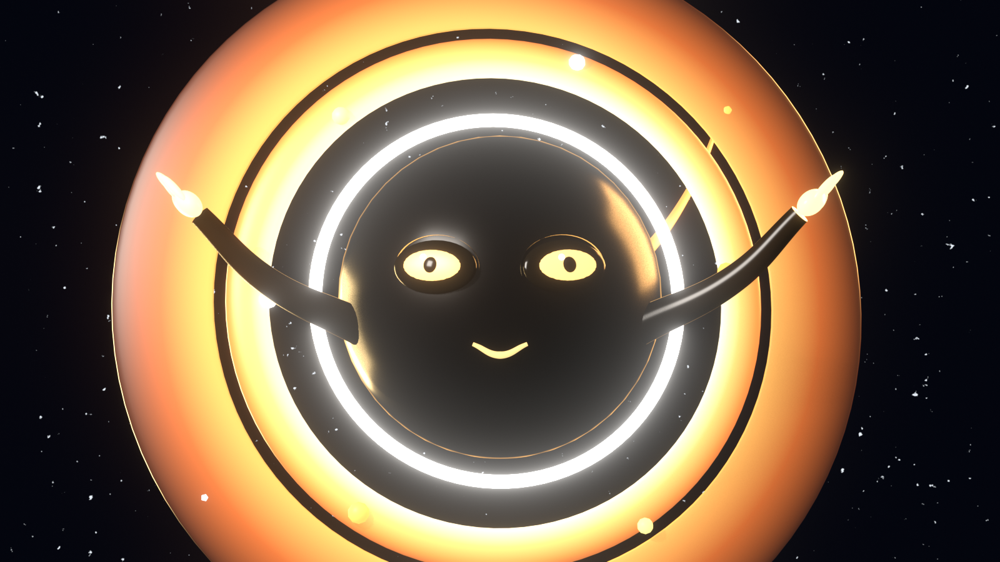

# Black Hole Mascot — "Event Horizon"

The player character of **blackHoleVR**: a living black-hole entity that the
player controls through space, absorbing matter to grow.



## Design

The mascot follows the art direction of the team's references: a **dark
obsidian sphere** framed by a **warm accretion halo** (white-hot core →
gold → orange → deep red), with a simple, friendly face that reads well at
any distance:

| Feature | Implementation |
|---|---|
| Body | Glossy near-black sphere with an amber fresnel rim |
| Accretion disk | 3 nested rings: hot core, gradient fire band, soft outer glow |
| Eyes | Luminous amber irises with radial glow, dark pupils, single glint |
| Eyelids | Almond shells that **blink** (2× per loop) |
| Mouth | Thin, subtle warm smile |
| Arms / hands | Sleek energy arms ending in hands with **4 fingers + thumb** |
| Debris | Hot sparks swirling inside the disk + orbiting debris |
| Tail | Faint infalling-matter wisp behind the body |

The character is **animated** (120-frame loop @ 30 fps): gentle floating bob,
arm waving, blinking, and orbiting debris.

## Files

| File | Purpose |
|---|---|
| `BlackHoleMascot.blend` | Full Blender 5.3 scene — open it and press **Space** to see the idle animation |
| `BlackHoleMascot.glb` | Unity-ready export: geometry + materials + animation in one file |
| `preview.png` | Render of frame 61 (eyes open) |
| `preview_blink.png` | Render of frame 37 (mid-blink) |
| `build_mascot.py` | Generator script — rebuild or tweak the mascot procedurally |

## Rebuilding

```powershell
blender --background --python build_mascot.py
```

Everything (model, materials, animation, lights, renders, exports) is created
from scratch by the script, so design tweaks (colors, sizes, timing) can be
made in the script and re-run in seconds.

## Importing into Unity

**Option A — glTF (recommended):**
1. Install a glTF package: `com.unity.cloud.gltfast` (Package Manager → Add by name).
2. Drag `BlackHoleMascot.glb` into the `Assets/` folder.
3. The hierarchy (`Mascot_Root` → eyes, arms, disk…) and the idle animation
   come in automatically.

**Option B — direct .blend import:**
1. Unity can import `.blend` files directly if Blender is installed and
   Unity's Editor Preferences point to `blender.exe`.
2. Drag `BlackHoleMascot.blend` into `Assets/`.

Notes for the team:
- The model is modeled facing **−Y** (Blender convention); glTF export
  converts to Unity's +Y-up automatically.
- Emissive materials export as glTF emission — pair with **URP bloom**
  (Volume → Bloom) for the halo glow in-game.
- Eyes, eyelids, arms and hands are separate objects, so expressions and
  gestures can be animated further in Unity.

## Regeneration

All content is generated by `build_mascot.py` (Blender 5.3 Python API).
The script is self-contained: it clears the scene, builds the character,
animates it, and writes every file listed above.
